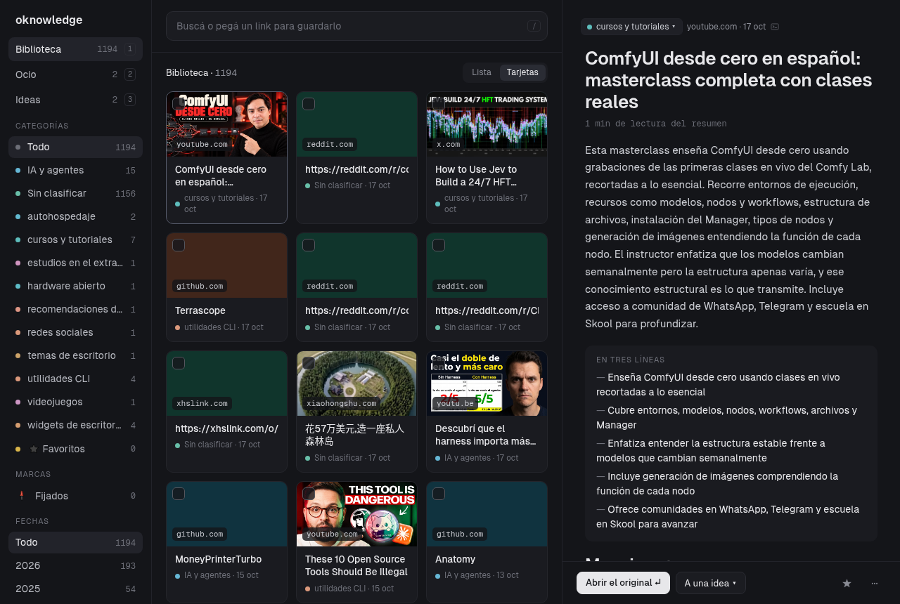

[English](README.md) · **Español**

# oknowledge — edición para Windows

Pegás un link y te queda una nota. oknowledge baja la página, la resume con un
motor de IA que no necesita API key, le pone categoría y etiquetas, y la
escribe como nota Markdown dentro de tu vault de Obsidian. Después recorrés y
buscás tu biblioteca desde una página en tu propio navegador.



**Este es un fork de oknowledge para quien no usa
[Omarchy](https://omarchy.org/).** El original es una herramienta de Linux con
un panel en la barra del sistema; todo lo que dependía de esa barra —o de
`flock`, o de `chmod`, o de un archivo de preferencias compartido— se fue o
tiene su mitad de Windows. Lo que queda es el mismo programa: el mismo
pipeline, las mismas notas, el mismo vault. Una nota escrita acá se abre en
Obsidian en Linux y al revés. Las diferencias están en
[En qué no es igual a la versión de Linux](#en-qué-no-es-igual-a-la-versión-de-linux).

## Qué hace

- Toma una URL (un artículo, un video de YouTube, un repositorio de GitHub, un
  PDF, un hilo de Reddit o cualquier cosa con texto legible) y le saca el
  texto. Ningún extractor ejecuta JavaScript ni abre un navegador: una página
  que necesita eso se guarda como incompleta.
- Analiza el texto con un motor de IA local o gratuito y escribe
  `<vault>/oknowledge/links/AAAA-MM-DD-<slug>.md` con un resumen, puntos
  clave, una categoría y de 3 a 8 etiquetas, más una nota índice por
  categoría.
- **Nunca pierde un link.** Si falla la extracción o la IA, la nota igual se
  crea, queda marcada `status: partial` y se puede terminar después.
- Levanta una página web local con toda tu biblioteca: un solo campo que busca
  mientras escribís y guarda lo que pegás, filtros por categoría, marca,
  colección y fecha, y un panel que lee la nota al lado de la lista. Anda en el
  celular que esté en el mismo wifi.
- **Ocio:** escribís `peli:Terminator` en vez de un link y te escribe una ficha
  de la película —año, géneros, elenco, puntaje y poster— sacada de un catálogo
  gratuito, y encima tu estado, tu nota y tu puntaje. Películas, series, anime
  y libros.
- **Ideas:** escribís lo que se te ocurrió y el modelo lo ordena —título,
  etiquetas, un resumen y los puntos— y le podés enganchar los links que
  guardaste.

No hay base de datos. El vault es la única fuente de verdad, y todos los
índices se reconstruyen leyendo el Markdown.

## Instalación

Necesitás [uv](https://docs.astral.sh/uv/) y nada más: él mismo instala
Python. Cuatro pasos en PowerShell, y el tercero es el único que te hace
pensar.

**1. uv**

```powershell
winget install --id=astral-sh.uv -e
```

Si el comando siguiente te dice que no conoce `uv`, cerrá esa ventana de
PowerShell y abrí otra: un programa recién instalado está en el PATH de las
ventanas que abras a partir de ahora, no en la que usaste para instalarlo.

**2. Este programa**

```powershell
git clone https://github.com/FerC10110/oknowledge-win.git
cd oknowledge-win
```

¿No tenés git? O `winget install --id=Git.Git -e` primero, o bajás el ZIP
desde el botón verde *Code* de esa página, lo descomprimís y entrás a la
carpeta con `cd`.

**3. Decile dónde está tu vault.** Una línea en
`%APPDATA%\oknowledge\config.toml`, que todavía no existe:

```powershell
mkdir $env:APPDATA\oknowledge -Force
notepad $env:APPDATA\oknowledge\config.toml
```

```toml
vault = "C:/Users/vos/Documents/obsidian"
```

Tu vault de Obsidian es la carpeta que abre Obsidian, la que tiene adentro la
carpeta `.obsidian`. Las notas van a `<vault>\oknowledge\`, que se crea sola la
primera vez que guardes un link. **Escribí la ruta con barras hacia adelante**:
mirá la aclaración en [El archivo de configuración](#el-archivo-de-configuración).

**4. Arrancalo**

```powershell
uv run oknowledge serve
```

La primera vez arma el entorno (un minuto, una sola vez) e imprime la
dirección de tu biblioteca, `http://127.0.0.1:8787/`. Dejá esa ventana
abierta: eso es el programa. `Ctrl+C` lo para.

Para tenerlo como un comando común en vez de `uv run`:

```powershell
uv tool install .
oknowledge serve
```

**Para los links de YouTube necesitás además `yt-dlp` en el PATH** (`uv tool
install yt-dlp`, o `winget install yt-dlp`). Todo lo demás anda sin eso.

Si no arranca, te dice por qué y sale con un código: todavía no hay archivo de
configuración (te imprime el mínimo que funciona), el vault no está donde
decís, o el puerto ya está ocupado. `oknowledge status` contesta lo mismo sin
levantar el servidor.

### El archivo de configuración

`%APPDATA%\oknowledge\config.toml`. Lo único obligatorio es `vault`; todo lo
demás tiene un valor por defecto. Corré `oknowledge status` una vez y te dice
dónde va el archivo y cómo es el más corto que sirve.

```toml
vault = "C:/Users/vos/Documents/obsidian"  # las notas van a <vault>/oknowledge/
folder = "oknowledge"                      # la carpeta adentro del vault
default_content = "full"                   # "full" guarda el texto original, "summary" no
batch = 10                                 # links que hace cada "Analizar" de Ajustes

[ai]
chain = ["opencode"]                       # motores a probar, en orden
language = "es"                            # idioma de lo que escribe la IA: "es" o "en"
mentions = "tools"                         # qué listar de un video de YouTube: "tools", "all" o "discussed"

[ai.opencode]
model = "opencode/ling-3.1-flash-free"

[ai.ollama]
model = "qwen2.5:7b"                       # tiene que ser un modelo que ya bajaste
url = "http://localhost:11434"

[ai.api]
provider = "groq"                          # la lista entera está en Ajustes
model = "llama-3.3-70b-versatile"

[web]
host = "127.0.0.1"                         # sólo esta máquina
port = 8787
language = "es"                            # la interfaz: "en" o "es"
idle_timeout = 0                           # segundos sin pedidos antes de apagarse; 0 = nunca
```

> **Escribí las rutas de Windows con barras hacia adelante.**
> `"C:/Users/vos/vault"` es TOML válido y Windows lo entiende.
> `"C:\Users\vos\vault"` no: entre comillas dobles, `\U` abre un escape
> unicode y `\t` es un tabulador, así que la línea o no parsea o apunta en
> silencio a algún lado que no existe. Las comillas simples también sirven:
> `'C:\Users\vos\vault'`. oknowledge te avisa cuando ve una, pero es más fácil
> no pisar el palito.

## Uso

**Un campo, dos trabajos.** El campo de arriba de la biblioteca busca mientras
escribís —títulos, resúmenes, puntos, etiquetas, lo que mencionó un video y el
texto completo, mostrándote el fragmento que coincide—. Si pegás un link en ese
mismo campo aparecen al lado la elección **Completo** / **Resumen** y el botón
**Guardar**: Completo deja el texto original dentro de la nota, Resumen no. La
página vuelve enseguida y la nota aparece en la biblioteca cuando el motor
termina: de segundos a un minuto, según el motor. Con `/` ponés el cursor ahí
desde cualquier lado.

**Tres columnas.** Las secciones y los filtros a la izquierda, la lista en el
medio, el link que estás leyendo a la derecha. Todo lo que tocás queda en la
barra de direcciones, así que una biblioteca filtrada es una URL que podés
recargar, guardar en favoritos o mandarte al celular.

- **Los filtros** son los grupos de la barra lateral, y se acumulan:
  CATEGORÍAS (más ★ Favoritos), MARCAS (📌 Fijados y cualquier otra que hayas
  usado), COLECCIONES (las tuyas, armadas desde el menú ⋯ de un link) y FECHAS
  —todos los años que tiene tu biblioteca, y los meses del que abras—. El
  tiempo cruza a los demás en vez de reemplazarlos: un año te mantiene la
  categoría que tenías puesta, y una categoría te mantiene el año. El *Todo* de
  cada grupo borra el suyo.
- **La lista** dibuja tarjetas o filas (el interruptor Tarjetas / Lista, o la
  tecla `v`), de a sesenta, y suma más a medida que llegás al final.
  **Seleccionar** prende las casillas para marcar, archivar o borrar de a
  muchos.
- **El panel** de la derecha es la nota: el resumen, los puntos clave, el texto
  original si la guardaste Completa, las etiquetas (tocás una y filtra, `e`
  para agregar), el chip de la categoría para moverla, ★ para marcarla
  favorita, *Abrir el original*, y un menú ⋯ para el resto: agregar a una
  colección, mandarla a una idea, reprocesar, borrar.
- **Borrar se puede deshacer.** Un cartelito te ofrece *Deshacer* unos
  segundos, y la nota igual se va a `<vault>\oknowledge\trash\`, así que
  Obsidian la puede recuperar más tarde. Nada en este proyecto borra una nota
  de verdad.
- **Ajustes y la ayuda de teclas se abren encima de la página**, desde el pie
  de la barra lateral. Ajustes se guarda solo mientras lo cambiás, panel por
  panel: los motores y sus modelos, los dos idiomas, con cuál de Completo /
  Resumen arranca, cuántos links analiza cada tanda, el import de WhatsApp y
  los renombres de categorías.
- **Las categorías** se renombran y se fusionan desde Ajustes, que reescribe
  las notas y los índices que haga falta.

**El teclado** (apretá `?` para ver esta lista):

| Tecla | Qué hace |
|---|---|
| `/` | buscar o pegar un link |
| `1` `2` `3` | Biblioteca · Ocio · Ideas |
| `j` `k` `←` `→` | link anterior / siguiente |
| `↑` `↓` | fila arriba / abajo |
| `↵` | abrir el link original |
| `f` | favorito |
| `e` | agregar una etiqueta |
| `x` | seleccionar |
| `⌫` | borrar lo seleccionado |
| `v` | lista / tarjetas |
| `esc` | cerrar / deseleccionar |

**Mientras corre:**

- Se queda prendido hasta que lo pares. Con `idle_timeout` en algunos segundos
  se apaga solo después de ese rato sin pedidos (por defecto `0`, nunca); el
  watchdog mira cada 5 segundos, así que ese apagado puede tardar hasta 5
  segundos de más.
- Si el puerto está ocupado sale con código 2 y te sugiere poner `web.port`.
- **Guardar los ajustes reescribe el archivo de configuración.** Los
  comentarios y las claves que no conoce no se conservan; el archivo anterior
  queda como `config.toml.bak`.

**En el celular** las tres columnas se vuelven una. Las secciones son una barra
abajo de todo (Biblioteca, Ocio, Ideas, Favoritos), los filtros son dos filas
de chips arriba de la lista —categorías, marcas y colecciones en la primera,
los años en la segunda— y un link se abre a pantalla completa, con ← para
volver. Una pulsación larga sobre una tarjeta prende la selección.

**Llegar desde el celular.** `[web] host = "0.0.0.0"` hace que el servidor
escuche en toda tu red y no sólo en esta máquina, e imprime la dirección que
tenés que escribir en el celular. Windows te va a preguntar una vez si dejás
pasar Python por el firewall: contestá que sí sólo para *redes privadas*.
Cualquiera en ese wifi puede entonces leer y cambiar tu vault, cosa que el
servidor también te dice en voz alta cuando arranca. El valor por defecto,
`127.0.0.1`, es esta máquina y nada más.

### Ocio

**Escribí un título, no un link.** `peli:Terminator` en el mismo campo le
pregunta a un catálogo en vez de bajar una página, y escribe la respuesta como
ficha en `<vault>\oknowledge\ocio\`. Nueve prefijos, en cuatro tipos:

| Lo que escribís | Tipo | Catálogo |
|---|---|---|
| `película:` `pelicula:` `peli:` `movie:` | película | Cinemeta |
| `serie:` `series:` | serie | Cinemeta |
| `anime:` | anime | Cinemeta, primero series y después películas |
| `libro:` `book:` | libro | Open Library |

No importan mayúsculas ni acentos (`PELÍCULA:`, `peli:`), se permite un espacio
alrededor de los dos puntos (`peli : Terminator`), y un título de más de 120
caracteres se corta ahí. Un prefijo sin nada atrás vuelve diciendo que falta el
título, y cualquier cosa que no sea una de esas nueve palabras se sigue
tratando como link: `https://…` y `nota:algo` siguen andando como siempre.

**Ninguno de los dos catálogos necesita API key**, y a ninguno se le cuenta
nada tuyo: [Cinemeta](https://v3-cinemeta.strem.io/) contesta por todo lo que
se filmó y [Open Library](https://openlibrary.org/) por todo lo que se imprimió.

- **Vos elegís cuál era.** Una búsqueda muestra hasta 16 candidatos con poster,
  año y puntaje. Cinemeta contesta "terminator" con Judgment Day primero y la
  película del 84 segunda, así que elegir es la gracia y no un trámite.
- **Dos atajos se saltean la lista:** un id (`movie:tt0088247`,
  `libro:OL27448W`) nombra una sola cosa, y también lo hace un año que deja
  exactamente un candidato (`peli:Terminator 1984`). Un año que no matchea con
  nadie deja la lista entera en pie, así que un dígito mal tipeado nunca te
  vacía la página.
- **La ficha se escribe enseguida, sin que intervenga ningún modelo**: el
  catálogo ya contestó. Lo que tarda minutos es la reescritura en el idioma de
  `[ai] language`, y eso pasa de fondo sobre una ficha que ya existe: el
  resumen y los puntos clave aparecen la próxima vez que mires la página. Hasta
  entonces la ficha dice *sin reescribir*, y su propia página te ofrece
  reescribirla. Los géneros salen siempre del catálogo; el modelo nunca toca
  las etiquetas.
- **Lo tuyo es tuyo:** un estado (*por ver / viendo / vista*, y *por leer /
  leyendo / leído* para un libro), un puntaje sobre cinco y una nota abajo de
  *Tu nota*. Se escriben directo en el frontmatter de la nota y ningún modelo
  los pisa. La página de Ocio filtra por tipo y por estado.

### Ideas

**Escribí lo que se te ocurrió; el modelo lo ordena.** La página de Ideas tiene
un formulario de *Nueva idea*: el texto es obligatorio, el título es opcional.
La idea se escribe enseguida en `<vault>\oknowledge\ideas\`, tu texto abajo del
encabezado *Mi nota*, y el resto llega por atrás de la página:

- **El modelo pone lo que sabe hacer:** un título si lo dejaste vacío, las
  etiquetas, un resumen de una línea y de tres a seis puntos —qué resuelve,
  para quién, cómo podría funcionar—. Hasta que lo haga, la idea dice *sin
  completar*, y su página te ofrece volver a preguntarle para cuando le hayas
  agregado algo.
- **Lo tuyo sigue siendo tuyo:** tu texto, un título que hayas escrito, el
  estado (*semilla / en marcha / hecha / descartada*), las estrellas y los
  links. Ningún modelo escribe ninguno de ésos. Las etiquetas son del modelo,
  como en toda la aplicación: volver a preguntarle las reescribe.
- **Un link se engancha a una idea desde la página del link**, con *A una
  idea*. La idea se lo queda como wikilink dentro de su propia nota, así se lee
  sola en Obsidian; cuando el pipeline renombra el archivo de un link, las
  ideas que lo nombraban lo siguen. Un link que ya no está en la biblioteca se
  muestra apagado, con una × para sacarlo.
- **Las ideas descartadas se guardan, no se muestran:** la sección las esconde
  hasta que elijas *descartada*.

#### Preguntarle sobre una idea

Cuatro botones en la página de una idea, cada uno escribe su propia sección
dentro de la nota, entre los puntos y tu texto:

- **¿Ya existe?** busca en la web lo mismo o algo parecido, con links. Necesita
  un motor que busque: opencode, o el motor api con el proveedor Anthropic. La
  respuesta se verifica: un modelo que contesta sin haber buscado es un error,
  no un veredicto.
- **Mejorar** marca los puntos flojos y cómo arreglarlos.
- **Ampliar** propone lo que la idea todavía no dice.
- **Links que pueden servir** elige, entre tus links guardados de una
  categoría, los que le sirven a la idea, cada uno con un botón para sumarlo.

Volver a preguntar reemplaza sólo esa sección. Tu texto no se toca nunca.

#### opencode corre sin sandbox

En Linux cada corrida de opencode queda encerrada con bubblewrap y pasta: sin
home, sin entorno, sin camino de vuelta a esta máquina. En Windows no existe
ninguno de los dos, así que acá opencode corre como viene, desde una carpeta
temporal vacía y lo más aislado que permiten sus propios flags —`--pure` en
opencode 1.x, y `--standalone` en 2.x, que sacó `--pure` y si no hablaría con
un servicio de fondo— y nada más. Es un agente con shell y con red, y un prompt
de **¿Ya existe?** lleva texto de páginas web: una página escrita para
manejarlo podría hacerle leer tus archivos o llamar al servidor de oknowledge.
Si eso te importa más que tener un motor gratis, sacá `opencode` de
`[ai] chain` y usá el motor api o ollama.

### La terminal

La opción global `--config RUTA` va antes del subcomando.

| Comando | Qué hace |
|---|---|
| `oknowledge add URL [--full\|--summary] [--engine NOMBRE] [--reprocess] [--json]` | procesa un link de punta a punta |
| `oknowledge status [--json]` | cuántas notas hay, y cada link pendiente, parcial o fallado |
| `oknowledge reindex` | reconstruye todos los índices de categoría desde las notas |
| `oknowledge retry [--limit N] [--json]` | termina los links que quedaron a medias, del más nuevo al más viejo |
| `oknowledge mentions [--limit N] [--json]` | agrega la lista de lo que nombra un video a los videos ya guardados |
| `oknowledge icons` | baja el favicon de cada sitio de la biblioteca, una vez por sitio |
| `oknowledge import ARCHIVO [--dry-run] [--json]` | importa los links de un export de WhatsApp, con la fecha en que los mandaste |
| `oknowledge serve [--open]` | levanta la página web |

Con `uv` y sin `uv tool install`, cada uno de ésos es `uv run oknowledge …`.

**`import` lee un export de chat de WhatsApp** (`Exportar chat` → `Sin
archivos`, que te da un `_chat.txt`) y guarda cada link como nota sin terminar,
fechada el día en que lo mandaste. Los números de teléfono, las notas para vos
mismo y cualquier otra cosa sin link se saltean. No se analiza nada: ése es el
trabajo de `retry`, y `retry --limit 50` lo hace de a tandas. Corrélo primero
con `--dry-run`; te lista lo que capturaría en tres grupos: los links escritos
con `https://`, los escritos como dominio pelado, y los mensajes que parecían
tener un link y no matchearon. Desde el navegador es Ajustes → Importar un
export de WhatsApp, y ahí la corrida en seco no es opcional.

Guardar el mismo link dos veces da una sola nota (`ya guardado`). Pegar un link
cuya nota está `partial` la termina en vez de duplicarla.

**`retry` termina lo que está sin terminar, y nada más.** Mira la cola, no tu
vault, y agarra cada entrada `partial` o `failed` más cada entrada `pending`
que ningún proceso vivo esté trabajando. Después, para cada una, le pregunta
primero al vault:

- **La nota está y su status no es `partial`**: la nota está terminada, así que
  `retry` no escribe nada. Marca la entrada como `ok` y sigue. No baja ninguna
  página ni le pregunta a ningún motor.
- **La nota es `partial`, o no hay nota**: éste es el caso para el que `retry`
  existe, y el link se procesa el resto del camino.
- **Otro proceso tiene el link**: lo deja en paz y lo reporta como `pending`,
  para el que lo tenga.

Esto importa porque una entrada de la cola puede sobrevivir al trabajo que
describe. Si el proceso se muere entre que escribió la nota y que anotó que
terminó —cerrar la terminal en medio de un guardado alcanza—, la entrada queda
`pending` para siempre mientras la nota en el disco está completa, y adentro de
esa nota puede haber semanas de lo que escribiste vos. `retry` trata a la nota
como lo real y a la cola como contabilidad: cuando no coinciden y la nota está
terminada, lo que se corrige es la contabilidad.

Una consecuencia, a propósito: un link guardado como resumen cuya entrada pedía
contenido completo se queda como resumen. Pedí vos la mejora cuando la quieras,
con `add --reprocess` o el botón Reprocesar de la web, que es lo único que sí
reemplaza el contenido de una nota.

`--limit N` termina como mucho N links y para, del más nuevo al más viejo. Así
se analiza un import grande: 1215 links son de 10 a 20 horas entre bajar
páginas y tiempo de modelo, así que `oknowledge retry --limit 50` una vez por
día los va sacando sin una corrida que no termina nunca.

**`mentions` les da su lista a los videos que ya están en la biblioteca.** Una
nota de YouTube lleva lo que el video nombró, escrito cuando el link se procesa
por primera vez; este comando hace lo mismo con los que guardaste antes.
Escribe la sección de menciones y nada más. Le pregunta a cada video una sola
vez, incluso cuando la respuesta viene vacía. Una nota cuyo encabezado
`## Menciones` no tiene nada abajo es una a la que se le preguntó y el video no
nombró nada: ésa no es una nota rota.

### Códigos de salida

| Código | Qué significa |
|---|---|
| 0 | anduvo |
| 1 | corrió, pero el link quedó sin terminar: una nota parcial, una entrada tomada por otro proceso, un `retry` que dejó links sin hacer |
| 2 | lo que pusiste vos está mal: argumentos, una URL vacía, una configuración que falta o está rota, un puerto ya ocupado |
| 3 | algo inesperado: un error de disco o de permisos, una escritura rechazada, un bug |

**Que salga distinto de cero no quiere decir que el link se haya perdido.** El
1 quiere decir que la nota existe pero no está analizada del todo. El 3 te
imprime si el link llegó a la cola. La regla sobre la que está construido el
proyecto es que un link no se pierde nunca.

## Motores

`[ai] chain` es a la vez el interruptor y la prioridad: los motores se prueban
en el orden de la lista, y un motor que no está en la lista no se usa nunca.
`--engine NOMBRE` fuerza uno para un link suelto.

| Motor | Cómo | Sale de tu máquina |
|---|---|---|
| `opencode` | `opencode run` aislado, en una carpeta temporal vacía | sí, al gateway de opencode |
| `ollama` | `/api/chat` local con salida JSON | **no**: el único motor enteramente local |
| `api` | cualquier proveedor con forma de OpenAI o de Anthropic, con tu key | sí, al proveedor |

Tanto `opencode` como `ollama` tienen builds de Windows; instalá cualquiera de
los dos y ponelo en el PATH. Si no tenés ninguno, usá `api`.

**`api` y la key.** Ajustes lista trece proveedores con la dirección en la que
vive cada uno y cuáles regalan una key gratis. Marcás uno y esa fila se abre
con la variable en la que va su key y un link a dónde se consigue, sin tener
que guardar nada antes. Después pegás la key en un archivo `.env` al lado de tu
configuración —`%APPDATA%\oknowledge\.env`— con un `NOMBRE=valor` por línea:

```
GROQ_API_KEY=gsk_…
```

Ajustes tiene un botón que te crea ese archivo con el nombre de variable ya
puesto. La key se lee sólo cuando está por salir un pedido: nunca va a una
variable de entorno (un subproceso la heredaría), nunca al archivo de
configuración que la página de ajustes reescribe, y nunca a una página.

**`fake` es un doble de pruebas.** Aparece en `oknowledge add --engine --help`
porque es un nombre de motor válido, pero sólo repite respuestas enlatadas para
la suite de tests. No lo elijas: no produce ningún análisis real.

## Los dos idiomas

Son independientes, y es común mezclarlos.

| | De dónde sale | Por defecto | Soporta |
|---|---|---|---|
| La interfaz | `[web] language` en `config.toml`, o los botones de Ajustes | inglés | `en`, `es` |
| Lo que escribe la IA (resumen, puntos, categoría, etiquetas, texto de los índices) | `[ai] language` en `config.toml` | `es` | `es`, `en` |

Una interfaz en inglés con resúmenes en español es una combinación normal.
Cambiar el idioma de la interfaz no toca ninguna nota guardada, y cambiar el
idioma del contenido afecta sólo a las notas que guardes después.

## El vault

```
<vault>\oknowledge\
  Redes.md                   índice de categoría, generado
  links\
    2026-10-03-wireguard-vs-openvpn.md
  ocio\                      las fichas, con sus propios índices
    Películas.md             índice por tipo, generado; el nombre sigue a [ai] language
    2026-10-11-the-terminator.md
  ideas\                     tus ideas, con su propio índice
    Ideas.md                 índice, generado
    2026-10-12-gimnasio-con-ia.md
  attachments\               las imágenes de portada
  trash\                     las notas borradas desde la página web
```

Una nota:

```markdown
---
url: https://example.com/article
title: WireGuard vs OpenVPN
category: Redes
tags: [vpn, privacidad, wireguard]
type: article        # article | youtube | github | pdf | social | other
source: example.com
saved: 2026-10-03
content: full        # full | summary
engine: opencode     # qué motor la escribió, cuando se sabe
status: ok           # ok | partial | failed
id: 9f2a1c4b8e07
oknowledge: 1
---

# WireGuard vs OpenVPN

(el resumen)

## Puntos clave
## Contenido original    <- sólo con content: full
```

Las claves del frontmatter, los nombres de archivo y el código están en inglés.
El resumen, los puntos, la categoría y las etiquetas salen en el idioma de
`[ai] language`.

**Editar a mano es parte del diseño.** Cambiá `category` o `tags` en Obsidian y
corré `oknowledge reindex`: los índices siguen. Borrá una nota y se va de su
índice.

**Las reglas de seguridad.** oknowledge escribe únicamente adentro de
`<vault>\oknowledge\`, y sólo en archivos cuyo frontmatter tiene `oknowledge:
1`. Un archivo sin esa marca no se modifica ni se borra nunca, aunque esté en
esa carpeta.

**`status` es un contrato.** `partial` es nuestro: la maquinaria puede
reescribirlo. Cualquier otro valor, incluido uno que escribas vos
(`status: done`, `revisada`), es tuyo: la maquinaria no va a pisar esa nota por
su cuenta.

## Dónde vive cada cosa

| Ruta | Qué |
|---|---|
| `%APPDATA%\oknowledge\config.toml` | tu configuración (y el `.bak` después de guardar desde la web) |
| `%APPDATA%\oknowledge\.env` | tu API key, si usás el motor `api` |
| `%LOCALAPPDATA%\oknowledge\` | `queue\` y `locks\`, un archivo por link, más la lista de modelos y las trazas |
| `<vault>\oknowledge\` | tus notas |

La configuración viaja con una cuenta de dominio y la cola no, y es a
propósito: la configuración es un archivo que escribiste vos, y la cola son
locks y trabajo a medio hacer que le pertenecen a la máquina que lo empezó. En
Linux esos dos son `~/.config/oknowledge/` y `$XDG_STATE_HOME/oknowledge/`, y
poner `XDG_CONFIG_HOME` o `XDG_STATE_HOME` los mueve en cualquiera de los dos
sistemas.

Para sacarlo: `uv tool uninstall oknowledge` si lo instalaste así, y después
borrá esas dos carpetas. Tus notas en `<vault>\oknowledge\` quedan intactas.

## En qué no es igual a la versión de Linux

| | Allá | Acá |
|---|---|---|
| El lock de la cola | `fcntl.flock` | `msvcrt.locking` sobre un byte del mismo archivo |
| Dónde van los archivos | `~/.config`, `$XDG_STATE_HOME` | `%APPDATA%`, `%LOCALAPPDATA%` |
| Permisos de archivo | `chmod 600` en la configuración y el `.env` | nada: el modo no decide nada en Windows, y lo que cuida el archivo son los permisos de la carpeta |
| El idioma de la interfaz | un archivo JSON compartido con los otros plugins de Omarchy | `[web] language` en la configuración |
| La durabilidad de una nota | se le hace `fsync` al directorio después de cada escritura | no: un directorio no tiene handle en Windows. La escritura en sí sigue siendo atómica |
| opencode | corre adentro de bubblewrap y pasta | corre sin sandbox: mirá *opencode corre sin sandbox* |

El lock cumple la única promesa sobre la que está construida la cola: le
pertenece al archivo abierto, así que cuando un proceso se muere el sistema lo
suelta. No hay timeout que adivinar ni corrida colgada que deje un link
pareciendo ocupado para siempre. Eso sí, `msvcrt` no tiene modo compartido, así
que *preguntar* si un link está ocupado toma el lock por un instante: un
segundo proceso que pregunte justo en ese momento cree que el link está ocupado
y lo deja para la próxima corrida. Nunca dos corridas sobre una nota, a veces
un link postergado.

## Límites conocidos

- **Esto no se corrió nunca en Windows.** Se escribió en una máquina Linux,
  contra el comportamiento documentado de `msvcrt.locking` y `%APPDATA%`, y se
  probó con un doble de `msvcrt`. Eso prueba la lógica, no el sistema
  operativo. Si sos el primero en correrlo ahí, lo que hay que mirar es el lock
  (dos `oknowledge retry` a la vez no tienen que agarrar los dos el mismo link)
  y las rutas (las carpetas de arriba tendrían que aparecer solas).
- **La suite de tests saltea 42 tests en Windows**, los que tienen como tema un
  modo de archivo POSIX, un fork, un flock, un symlink o la umask. No se
  borraron, porque en Linux son la prueba que siempre fueron. La primera
  corrida real en Windows puede encontrar algunos más para marcar.
- **La primera carga de la página es lenta con una biblioteca grande.** Armar
  el índice de búsqueda se midió en 6,1 segundos para 3000 notas. No está roto.
- **Reddit puede contestarle 403 a un User-Agent por defecto.** Ahí la nota se
  guarda como `partial`. X, Instagram y TikTok también suelen bloquear.
- **Las URLs de localhost y de la red local se bajan a propósito.** oknowledge
  no filtra direcciones privadas.
- **La velocidad del análisis es la de tu máquina.** Los motores corren local
  (o en un gateway gratuito), así que un link puede tardar de segundos a un
  minuto o más.
- Las páginas que necesitan JavaScript o un login quedan `partial`.
- PDFs: las primeras 20 páginas, sólo la capa de texto (no hay OCR).

## Desarrollo

```powershell
uv run --extra dev pytest -W error
```

Ningún test toca la red ni levanta un programa. `-W error` no es opcional en
este proyecto: un warning al que se le permite imprimirse es un warning que no
lee nadie.

```
src/oknowledge/
  cli.py         add, import, status, reindex, retry, serve
  pipeline.py    un link de punta a punta; queue.py los archivos de estado
  locking.py     el lock de la cola, una implementación por sistema
  places.py      dónde viven la configuración y el estado, según el sistema
  perms.py       hacer que un archivo sea sólo tuyo, donde eso signifique algo
  whatsapp.py    un export a links fechados; sin disco, sin red
  extract/       article, youtube, github, pdf, social
  ai/            opencode, ollama, api, fake; providers.py; prompts/
  vault.py       la única capa que escribe Markdown
  web/           la app FastAPI, las plantillas, los estáticos
docs/            documentos de diseño y de plan, en español
```

Los arreglos vienen de upstream en vez de escribirse dos veces. Este fork se
cortó del repositorio de Linux y lo sigue: todo cambio de allá que no sea de
bubblewrap, `flock`, `chmod` o la barra de Omarchy se cherry-pickea acá, y la
suite de tests se mantiene en la misma cantidad. Lo que es sólo de Windows vive
en `locking.py`, `places.py` y `perms.py`, cada uno un módulo que la otra
versión también tiene, con la otra mitad de la misma pregunta.

## Licencia

MIT
