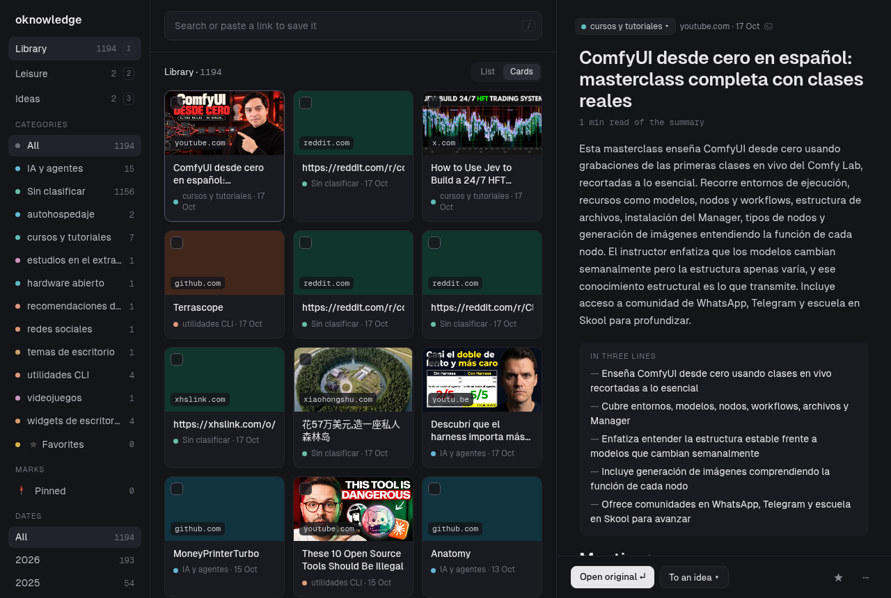

# oknowledge — the Windows edition

Paste a link, get a note. oknowledge downloads the page, summarizes it with an
AI engine that needs no API key, gives it a category and tags, and writes it as
a Markdown note into your Obsidian vault. Then you browse and search your
library from a page in your own browser.



**This is a fork of oknowledge for people without
[Omarchy](https://omarchy.org/).** The original is a Linux tool
with a panel in the system bar; everything that needed that bar — or needed
`flock`, or `chmod`, or a shared preference file — is gone or has a Windows
half. What is left is the same program: the same pipeline, the same notes, the
same vault. A note written here opens in Obsidian on Linux and the other way
round. The differences are listed under
[What is not the same](#what-is-not-the-same-as-the-linux-version).

## What it does

- Takes a URL (article, YouTube video, GitHub repository, PDF, Reddit thread,
  or anything else with readable text) and extracts its text. No extractor runs
  JavaScript or opens a browser: a page that needs one is saved as incomplete.
- Analyses the text with a local or free AI engine and writes
  `<vault>/oknowledge/links/YYYY-MM-DD-<slug>.md` with a summary, key points,
  a category and 3 to 8 tags, plus one index note per category.
- **Never loses a link.** If extraction or the AI fails, the note is still
  created, marked `status: partial`, and can be finished later.
- Runs a local web page: paste a link, library, search, categories, settings.
- **Leisure:** type `movie:Terminator` instead of a link and it writes a card
  for the film — year, genres, cast, rating and poster — out of a free
  catalogue, then your own state, score and note on top. Films, series, anime
  and books.

There is no database. The vault is the only source of truth, and every index is
rebuilt by reading the Markdown.

## Install

You need [uv](https://docs.astral.sh/uv/) and nothing else — it installs
Python itself. In PowerShell:

```powershell
winget install --id=astral-sh.uv -e
```

Then, from the folder you unpacked this into:

```powershell
uv run oknowledge serve
```

That is the whole install: `uv` builds the environment the first time and
prints the address of your library. To have it as a plain command instead:

```powershell
uv tool install .
oknowledge serve
```

**For YouTube links you also need `yt-dlp` on the PATH** (`uv tool install
yt-dlp`, or `winget install yt-dlp`). Everything else works without it.

### The config file

`%APPDATA%\oknowledge\config.toml`. Only `vault` is required; everything else
has a default. Run `oknowledge status` once and it tells you where the file
goes and what the shortest one looks like.

```toml
vault = "C:/Users/you/Documents/obsidian"  # notes go to <vault>/oknowledge/
folder = "oknowledge"                      # the folder inside the vault
default_content = "full"                   # "full" keeps the original text, "summary" does not
batch = 10                                 # links the Analyse button does per click

[ai]
chain = ["opencode"]                       # engines to try, in order
language = "es"                            # language of the generated content: "es" or "en"
mentions = "tools"                         # what to list for a YouTube video: "tools", "all" or "discussed"

[ai.opencode]
model = "opencode/ling-3.1-flash-free"

[ai.ollama]
model = "qwen2.5:7b"                       # must be a model you have pulled
url = "http://localhost:11434"

[ai.api]
provider = "groq"                          # see Settings for the whole list
model = "llama-3.3-70b-versatile"

[web]
host = "127.0.0.1"                         # this machine only
port = 8787
language = "en"                            # the interface: "en" or "es"
idle_timeout = 0                           # seconds without a request before it stops; 0 = never
```

> **Write Windows paths with forward slashes.** `"C:/Users/you/vault"` is
> valid TOML and Windows understands it. `"C:\Users\you\vault"` is not: in
> double quotes, `\U` starts a unicode escape and `\t` is a tab, so the line
> either fails to parse or quietly points somewhere that does not exist.
> Single quotes also work: `'C:\Users\you\vault'`. oknowledge says so when it
> sees one, but it is easier not to hit it.

## Use

**The paste box** is in the header of every page: paste a link, then **Full**
(keeps the original text in the note) or **Summary** (does not). The page comes
back at once and the note shows up in the library when the engine is done —
seconds to a minute, depending on the engine.

**The rest of the page:** Library (cards, filter by category and tag), Search
(title, summary, points, tags, what a video mentioned, and the full text, with
the matching fragment), Item (change category, edit tags, reprocess, delete),
Categories (rename and merge, rewriting the affected notes and indexes),
Import (a WhatsApp export, previewed before it is written), Analyse (a batch of
the links still waiting, with a bar) and Settings.

- It stays up until you stop it. With `idle_timeout` set to some seconds it
  shuts itself down after that long without requests (default `0`, never); the
  watchdog polls every 5 seconds, so that shutdown can be up to 5 seconds late.
- If the port is taken it exits with code 2 and suggests setting `web.port`.
- **Delete moves the note to `<vault>\oknowledge\trash\`**, so you can recover
  it from Obsidian. Nothing in this project unlinks a note.
- **Saving settings rewrites the config file.** Comments and keys it does not
  know are not preserved; the previous file is kept as `config.toml.bak`.

**Reaching it from your phone.** `[web] host = "0.0.0.0"` makes the server
listen on your whole network instead of only this machine, and it prints the
address to type on the phone. Windows will ask once whether to allow Python
through the firewall — answer for *private networks* only. Anyone on that
wifi can then read and change your vault, which the server also says out loud
when it starts. The default, `127.0.0.1`, is this machine and nothing else.

### Leisure

**Type a title, not a link.** `movie:Terminator` in the same paste box asks a
catalogue instead of downloading a page, and writes the answer as a card in
`<vault>\oknowledge\ocio\`. Nine prefixes, in four kinds:

| What you type | Kind | Catalogue |
|---|---|---|
| `película:` `pelicula:` `peli:` `movie:` | movie | Cinemeta |
| `serie:` `series:` | series | Cinemeta |
| `anime:` | anime | Cinemeta, series first and then films |
| `libro:` `book:` | book | Open Library |

Case and accents do not matter (`PELÍCULA:`, `peli:`), a space around the colon
is allowed (`peli : Terminator`), and a title longer than 120 characters is
cut there. A prefix with nothing after it comes back saying the title is
missing, and anything that is not one of those nine words is still treated as
a link — `https://…` and `note:something` go the way they always did.

**Neither catalogue needs an API key**, and neither is asked anything about
you: [Cinemeta](https://v3-cinemeta.strem.io/) answers for anything that was
filmed and [Open Library](https://openlibrary.org/) for anything that was
printed.

- **You pick which one you meant.** A search shows up to 16 candidates with
  poster, year and rating. Cinemeta answers "terminator" with Judgment Day
  first and the 1984 film second, so picking is the feature rather than a step
  in the way.
- **Two shortcuts skip the list:** an id (`movie:tt0088247`, `book:OL27448W`)
  names one thing, and so does a year that leaves exactly one candidate
  (`movie:Terminator 1984`). A year nobody matches leaves the whole list
  standing, so a mistyped digit never empties the page.
- **The card is written at once, with no model involved** — the catalogue
  already answered. What takes minutes is the rewrite in the language of
  `[ai] language`, and that happens in the background over a card that already
  exists: the summary and the key points show up on the next page view. Until
  then the card says *not rewritten*, and its own page offers the rewrite
  again. The genres always come from the catalogue; the model never touches
  the tags.
- **Your part is yours:** a state (*to watch / watching / watched*, and *to
  read / reading / read* for a book), a score out of five and a note under
  *Your note*. They are written straight into the note's frontmatter and no
  model ever overwrites them. The Leisure page filters by kind and by state.

### Ideas

**Write what occurred to you; the model files it.** The Ideas page has a *New
idea* form: the text is required, the title is optional. The idea is written
at once into `<vault>\oknowledge\ideas\`, your text under the note heading
(*My note*, or *Mi nota* with `[ai] language = "es"`), and the rest comes in
behind the page:

- **The model fills in what it is good at:** a title if you left it empty,
  the tags, a one-line summary and three to six points — what it solves, for
  whom, how it could work. Until it has, the idea says *not completed*, and
  its page offers to ask again for when you have added to it.
- **What is yours stays yours:** your text, a title you typed, the state
  (*seed / under way / done / dropped*), the stars and the links. No model
  writes any of them. The tags are the model's, as everywhere else in the
  app: asking again rewrites them.
- **A link joins an idea from the link's own page**, with *Add to an idea*.
  The idea keeps it as a wikilink in its own note, so it reads on its own in
  Obsidian; when the pipeline renames a link's file, the ideas that named it
  follow. A link that is not in the library any more shows dimmed, with an ×
  to take it off.
- **Dropped ideas are kept, not shown:** the section hides them until you
  pick *dropped*.

#### Asking about an idea

Four buttons on an idea's page, each writing its own section into the
idea's note, between the points and your text:

- **Already out there?** searches the web for the same thing or something
  close, with links. It needs an engine that searches: opencode, or the API
  engine with the Anthropic provider. The answer is checked: a model that
  answers without having searched is an error, not a verdict.
- **Improve** points out weak spots and how to fix them.
- **Expand** proposes what the idea does not say yet.
- **Links that may help** picks, among your saved links of a category,
  the ones that serve the idea, each with an **Add to the idea** button.

Asking again replaces that section only. Your text is never touched.

#### opencode runs without a sandbox

On Linux every opencode run is locked in with bubblewrap and pasta: no home,
no environment, no way back to this machine. Neither exists on Windows, so
here opencode runs as it is, with `--pure` and from an empty temporary
folder, and nothing more. It is an agent with a shell and the network, and
an **Already out there?** prompt carries text from web pages: a page written
to steer it could have it read your files or call the oknowledge server. If
that matters more than a free engine, take `opencode` out of `[ai] chain`
and use the API engine or ollama.

### The terminal

The global option `--config PATH` goes before the subcommand.

| Command | What it does |
|---|---|
| `oknowledge add URL [--full\|--summary] [--engine NAME] [--reprocess] [--json]` | process one link end to end |
| `oknowledge status [--json]` | note count, and every link that is pending, partial or failed |
| `oknowledge reindex` | rebuild every category index from the notes |
| `oknowledge retry [--limit N] [--json]` | finish the links left half done, newest first |
| `oknowledge mentions [--limit N] [--json]` | add the list of what a video names to the videos already saved |
| `oknowledge icons` | fetch the favicon of every site in the library, once per site |
| `oknowledge import FILE [--dry-run] [--json]` | import the links out of a WhatsApp export, dated when you sent them |
| `oknowledge serve [--open]` | start the web page |

With `uv` and no `uv tool install`, each of those is `uv run oknowledge …`.

**`import` reads a WhatsApp chat export** (`Export chat` → `Without media`,
which gives a `_chat.txt`) and saves every link in it as an unfinished note
dated the day you sent it. Phone numbers, notes to self and anything else
without a link are skipped. Nothing is analysed: that is `retry`'s job, and
`retry --limit 50` does it in batches. Run it with `--dry-run` first; it lists
what it would capture in three groups — the links written with `https://`, the
ones written as a bare domain, and the messages that looked like they had a
link and did not match. From the browser it is Settings → Import a WhatsApp
export, and there the dry run is not optional.

Saving the same link twice gives one note (`already saved`). Pasting a link
whose note is `partial` finishes it instead.

**`retry` finishes what is unfinished, and nothing else.** It looks at the
queue, not at your vault, and takes every entry that is `partial` or `failed`
plus every `pending` entry no live process is working on. Then, for each one,
it asks the vault first:

- **The note is there and its status is not `partial`** — the note is finished,
  so `retry` writes nothing. It marks the entry `ok` and moves on. No page is
  fetched, no engine is asked.
- **The note is `partial`, or there is no note** — this is the case `retry` is
  for: the link is processed the rest of the way.
- **Another process holds the link** — it is left alone and reported as
  `pending`, for whoever holds it.

This matters because a queue entry can outlive the work it describes. If the
process is killed between writing the note and recording that it finished —
closing the terminal mid-save does it — the entry stays `pending` forever while
the note on disk is complete, and weeks of your own writing can be sitting in
that note. `retry` treats the note as the real artifact and the queue as
bookkeeping: when they disagree and the note is finished, it is the bookkeeping
that gets corrected.

One consequence, on purpose: a link saved as a summary whose entry asked for
full content stays a summary. Ask for the upgrade when you want it, with
`add --reprocess` or the web's Reprocess button — the one thing that does
replace a note's content.

`--limit N` finishes at most N links and stops, newest first. That is how a
large import gets analysed: 1215 links are 10 to 20 hours of fetching and
model time, so `oknowledge retry --limit 50` once a day works through them
without a run that never ends.

**`mentions` gives the videos already in the library their list.** A YouTube
note carries what the video named, written when the link is first processed;
this command does the same for the ones saved before. It writes the mentions
section and nothing else. It asks each video once, even when the answer is
empty. A note whose `## Menciones` heading has nothing under it was asked and
the video named nothing; that is not a broken note.

### Exit codes

| Code | Meaning |
|---|---|
| 0 | it worked |
| 1 | it ran, but the link is unfinished: a partial note, an entry locked by another process, a `retry` that left some links undone |
| 2 | your input or config is wrong: bad arguments, an empty URL, a missing or malformed config, a port already in use |
| 3 | something unexpected: a disk or permission error, a refused write, a bug |

**A nonzero exit does not mean the link was lost.** Exit 1 means the note
exists but is not fully analysed. Exit 3 prints whether the link reached the
queue. The rule the project is built around is that a link is never lost.

## Engines

`[ai] chain` is both the switch and the priority: engines are tried in the
order listed, and an engine not in the list is never used. `--engine NAME`
forces one for a single link.

| Engine | How | Leaves your machine |
|---|---|---|
| `opencode` | `opencode run --pure` in an empty temp directory | yes, to opencode's gateway |
| `ollama` | local `/api/chat` with JSON output | **no**: the only fully local engine |
| `api` | any OpenAI- or Anthropic-shaped provider, with your key | yes, to the provider |

Both `opencode` and `ollama` have Windows builds; install either one and put it
on the PATH. With neither, use `api`.

**`api` and the key.** Settings lists thirteen providers with the address each
one lives at and which of them hand out a free key. Tick one and that row
opens with the variable its key goes in and a link to where you get it — no
saving first. Then paste the key into a `.env` file next to your config —
`%APPDATA%\oknowledge\.env` — one `NAME=value` per line:

```
GROQ_API_KEY=gsk_…
```

Settings has a button that creates that file for you with the right variable
name already in it. The key is read only when a request is about to be made:
it never goes into an environment variable (a subprocess would inherit it),
never into the config file the settings page rewrites, and never onto a page.

**`fake` is a test double.** It shows up in `oknowledge add --engine --help`
because it is a valid engine name, but it only replays canned replies for the
test suite. Do not select it: it produces no real analysis.

## The two languages

They are independent, and it is common to mix them up.

| | Where it comes from | Default | Supported |
|---|---|---|---|
| The interface | `[web] language` in `config.toml`, or the radio buttons in Settings | English | `en`, `es` |
| AI content (summary, points, category, tags, index boilerplate) | `[ai] language` in `config.toml` | `es` | `es`, `en` |

An English interface with Spanish summaries is a normal setup. Changing the
interface language never touches saved notes, and changing the content language
only affects notes saved afterwards.

## The vault

```
<vault>\oknowledge\
  Networking.md              category index, generated
  links\
    2026-10-03-wireguard-vs-openvpn.md
  ocio\                      leisure cards, with their own indexes
    Películas.md             kind index, generated; the name follows [ai] language
    2026-10-11-the-terminator.md
  ideas\                     your ideas, with their own index
    Ideas.md                 index, generated
    2026-10-12-gimnasio-con-ia.md
  attachments\               cover images
  trash\                     notes deleted from the web page
```

A note:

```markdown
---
url: https://example.com/article
title: WireGuard vs OpenVPN
category: Networking
tags: [vpn, privacy, wireguard]
type: article        # article | youtube | github | pdf | social | other
source: example.com
saved: 2026-10-03
content: full        # full | summary
engine: opencode     # which engine wrote this, when it is known
status: ok           # ok | partial | failed
id: 9f2a1c4b8e07
oknowledge: 1
---

# WireGuard vs OpenVPN

(summary)

## Key points
## Original content    <- only with content: full
```

Frontmatter keys, file names and code are in English. The summary, points,
category and tags come out in the language of `[ai] language`.

**Editing by hand is part of the design.** Change `category` or `tags` in
Obsidian and run `oknowledge reindex`: the indexes follow. Delete a note and it
leaves its index.

**The safety rules.** oknowledge writes only inside `<vault>\oknowledge\`, and
only into files whose frontmatter has `oknowledge: 1`. A file without that
marker is never modified or deleted, even inside that folder.

**`status` is a contract.** `partial` is ours: the machinery may rewrite it.
Any other value, including one you type yourself (`status: done`, `reviewed`),
is yours: the machinery will not overwrite that note on its own.

## Where everything lives

| Path | What |
|---|---|
| `%APPDATA%\oknowledge\config.toml` | your config (and `.bak` after a web save) |
| `%APPDATA%\oknowledge\.env` | your API key, if you use the `api` engine |
| `%LOCALAPPDATA%\oknowledge\` | `queue\` and `locks\`, one file per link, plus the model list and any traces |
| `<vault>\oknowledge\` | your notes |

The config roams with a domain account and the queue does not, which is on
purpose: the config is a file you wrote, and the queue is locks and
half-finished work belonging to the machine that started it. On Linux the same
two are `~/.config/oknowledge/` and `$XDG_STATE_HOME/oknowledge/`, and setting
`XDG_CONFIG_HOME` or `XDG_STATE_HOME` moves them on either system.

To remove it: `uv tool uninstall oknowledge` if you installed it that way, then
delete those two folders. Your notes in `<vault>\oknowledge\` are left alone.

## What is not the same as the Linux version

| | There | Here |
|---|---|---|
| The queue's lock | `fcntl.flock` | `msvcrt.locking` on one byte of the same file |
| Where the files go | `~/.config`, `$XDG_STATE_HOME` | `%APPDATA%`, `%LOCALAPPDATA%` |
| File permissions | `chmod 600` on the config and the `.env` | nothing: the mode decides nothing on Windows, and the folder's permissions are what guard the file |
| The interface language | a JSON file shared with the other Omarchy plugins | `[web] language` in the config |
| A note's durability | the directory is `fsync`ed after each write | it is not: a directory has no handle on Windows. The write itself is still atomic |
| opencode | runs inside bubblewrap and pasta | runs without a sandbox: see *opencode runs without a sandbox* |

The lock keeps the one promise the queue is built on: it belongs to the open
file, so when a process dies the system drops it. There is no timeout to guess
at and no crashed run that leaves a link looking busy forever. `msvcrt` has no
shared mode, though, so *asking* whether a link is busy takes the lock for an
instant there — a second process asking at that exact moment believes the link
is busy and leaves it for the next run. Never two runs on one note, sometimes
one link postponed.

## Known limits

- **This has not been run on Windows.** It was written on a Linux machine,
  against the documented behaviour of `msvcrt.locking` and `%APPDATA%`, and
  tested with a stand-in for `msvcrt`. That proves the logic and not the
  operating system. If you are the first to run it there, the things to watch
  are the lock (two `oknowledge retry` at once must not both take a link) and
  the paths (the folders above should appear by themselves).
- **The test suite skips 42 tests on Windows**, the ones whose subject is a
  POSIX file mode, a fork, a flock, a symlink or a umask. They are not deleted,
  because on Linux they are the proof they always were. The first real run on
  Windows may find a few more that need marking.
- **First page load is slow on a big library.** Building the search index was
  measured at 6.1 seconds for 3000 notes. It is not broken.
- **Reddit can answer a default User-Agent with 403.** Then the note is saved
  as `partial`. X, Instagram and TikTok usually block as well.
- **Localhost and LAN URLs are fetched on purpose.** oknowledge does not filter
  private addresses.
- **Analysis speed is your machine's.** The engines run locally (or on a free
  gateway), so a link can take from seconds to a minute or more.
- Pages that need JavaScript or a login become `partial`.
- PDFs: first 20 pages, text layer only (no OCR).

## Development

```powershell
uv run --extra dev pytest -W error
```

No test touches the network or starts a program. `-W error` is not optional in
this project: a warning that is allowed to print is a warning nobody reads.

```
src/oknowledge/
  cli.py         add, import, status, reindex, retry, serve
  pipeline.py    one link end to end; queue.py the state files
  locking.py     the queue's lock, one implementation per system
  places.py      where the config and the state live, per system
  perms.py       making a file yours alone, where that means anything
  whatsapp.py    an export to dated links; no disk, no network
  extract/       article, youtube, github, pdf, social
  ai/            opencode, ollama, api, fake; providers.py; prompts/
  vault.py       the only layer that writes Markdown
  web/           FastAPI app, templates, static
docs/            design and plan documents, in Spanish
```

Fixes come from upstream rather than being written twice: `origin` is the
Linux repository, and this fork was cut from its `feat/mentions-search`
branch, so `git pull origin feat/mentions-search` brings them here.

## License

MIT
